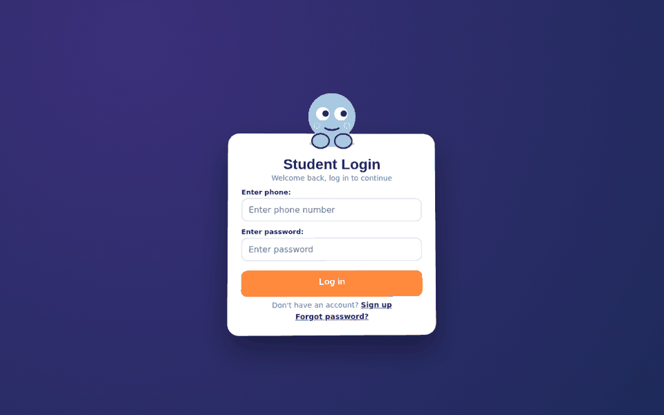
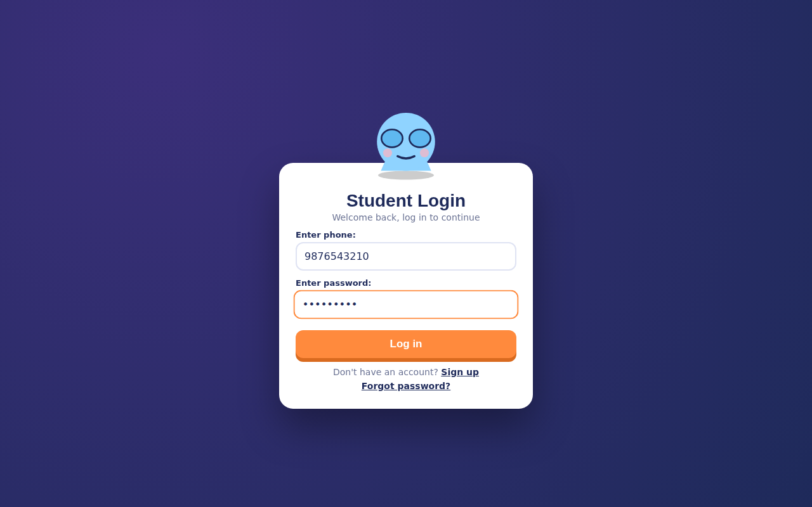
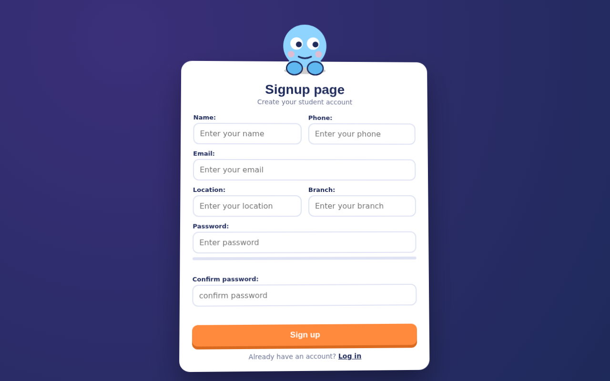
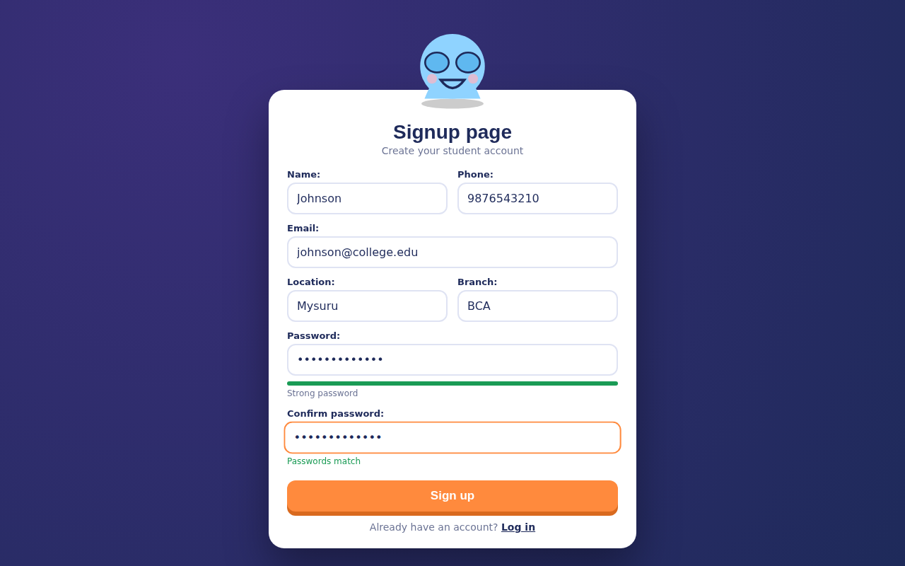
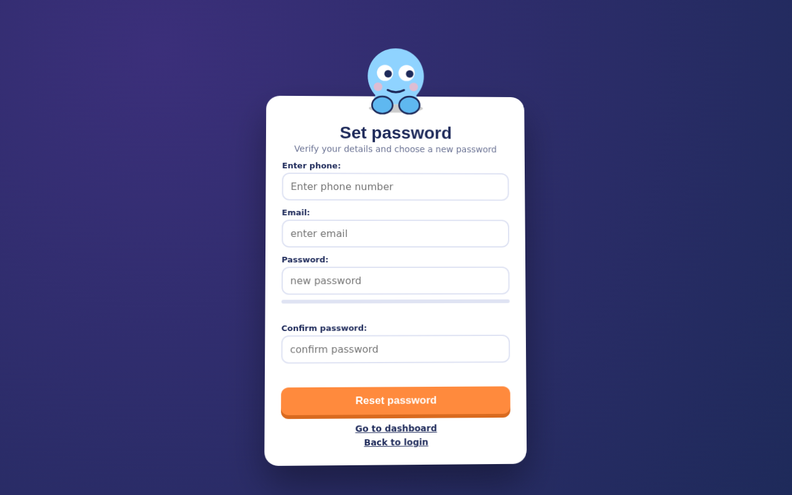
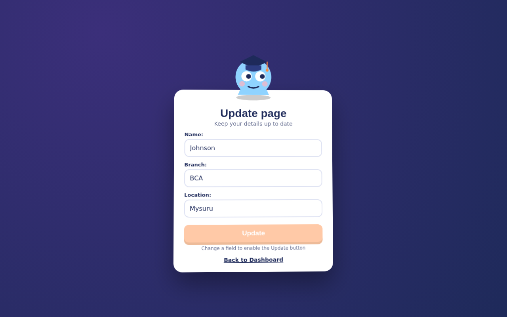
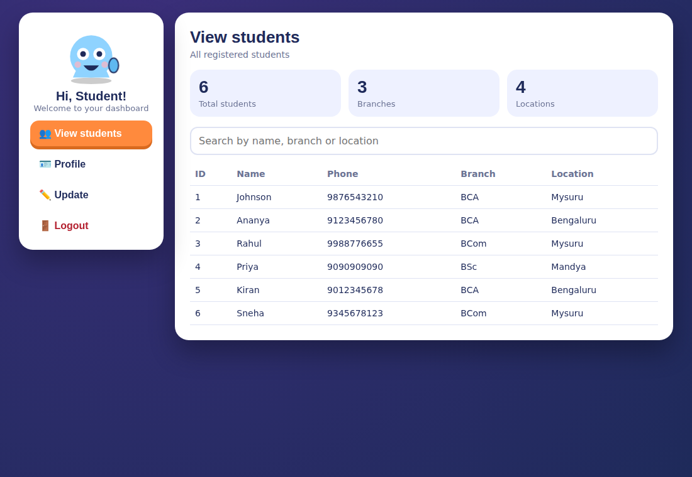
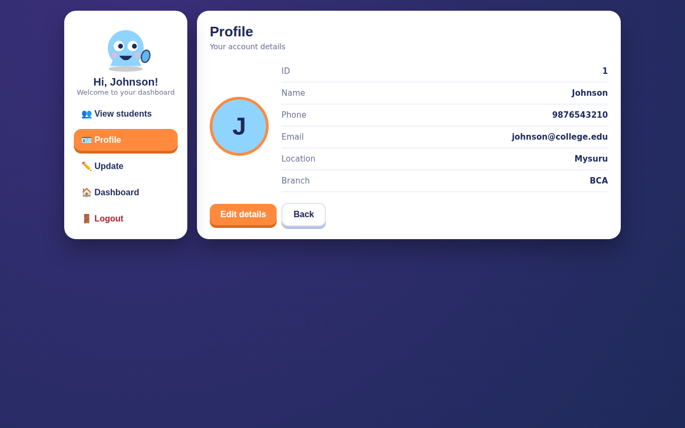
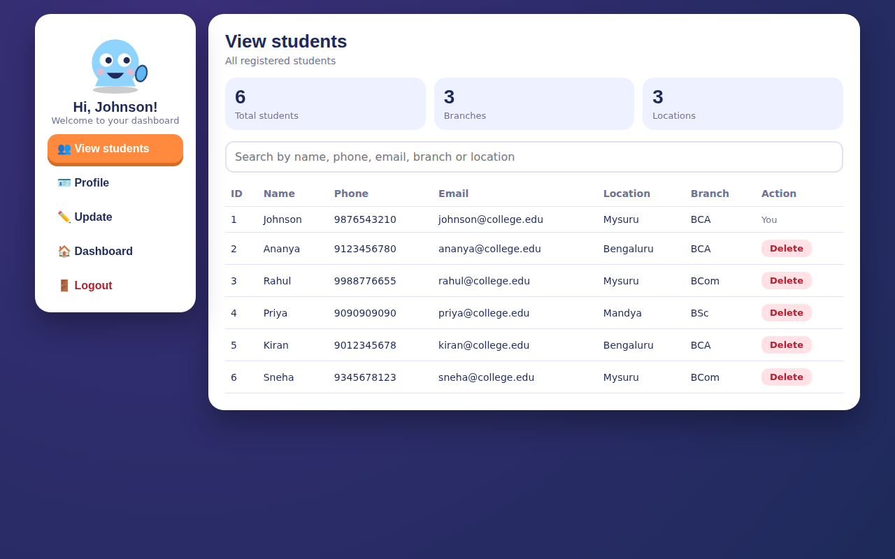

<div align="center">

# 🎓 Student Management System

**A full stack Java web app with a friendly animated mascot, 3D card effects and an admin dashboard.**


[**▶ Live UI demo**](https://imjohnson07.github.io/StudentManagement/) · [Screenshots](#-screenshots) · [Getting started](#-getting-started)



</div>

## ✨ About

Student Management System is a role-based web application built with **Java, Servlets, JSP and JDBC**. Students can sign up, log in, reset their password, view and update their profile. The admin can see every registered student and remove accounts.

The front end goes beyond a plain form: an animated mascot follows your cursor, covers its eyes while you type a password, reacts to password strength, and celebrates or looks sad depending on the result.

## 🚀 Features

| Area | What it does |
|---|---|
| **Signup** | Name, phone, email, location, branch, password with live strength bar and confirm check |
| **Login** | Phone and password login with session handling and friendly error feedback |
| **Set password** | Verify phone and email, then choose a new password |
| **Dashboard** | Sidebar menu with View students, Profile, Update and Logout |
| **Profile** | See your ID, name, phone, email, location and branch |
| **Update** | Edit name, branch and location, with the button enabled only when something changed |
| **Admin: View students** | Stat cards, live search and a student table |
| **Admin: Delete** | Delete with a confirmation pop-up, and no self-delete |
| **Logout** | Confirmation pop-up, then the session is cleared |

### 🎨 UI highlights

- Mascot whose eyes follow the mouse and whose mood changes with form state
- 3D card tilt, flip and rise-in animations
- Animated count-up stat cards
- Responsive layout for desktop and mobile
- Respects `prefers-reduced-motion` and has keyboard focus styles

## 📸 Screenshots

| Login | Login (typing password) |
|:---:|:---:|
|  |  |

| Signup | Signup (strong password) |
|:---:|:---:|
|  |  |

| Set password | Update |
|:---:|:---:|
|  |  |

| Dashboard | Profile |
|:---:|:---:|
|  |  |

| Admin: View students |
|:---:|
|  |

## 🛠 Tech stack

- **Back end:** Java 21, Servlets, JDBC
- **View:** JSP, HTML5, CSS3, vanilla JavaScript (SVG mascot, CSS 3D transforms)
- **Database:** MySQL
- **Server:** Apache Tomcat
- **IDE:** Eclipse (Dynamic Web Project)

## 🧭 How it works

```
Browser (JSP + CSS/JS)  →  Servlet (signup, login, update, ...)  →  DAO (JDBC)  →  MySQL
         ↑                                  │
         └────── forward / redirect ────────┘   (session holds the logged-in Student)
```

- The logged-in student is stored in the HTTP session.
- Pages redirect to `login.jsp` when there is no session.
- The first registered account (ID 1) is the admin and gets the **View students** menu.

## 📁 Project structure

```
StudentManagement
├── src/main/java
│   └── com.studentApp.*        servlets, DAO and DTO classes
├── src/main/webapp
│   ├── login.jsp
│   ├── signup.jsp
│   ├── forgotpassword.jsp
│   ├── dashboard.jsp
│   ├── viewstudents.jsp
│   ├── profile.jsp
│   └── update.jsp
└── docs                        screenshots, demo GIF and the live UI demo
```

## ⚙ Getting started

### Prerequisites

- JDK 21
- Apache Tomcat
- MySQL 8 or newer
- Eclipse IDE for Enterprise Java and Web Developers

### 1. Clone the repository

```bash
git clone https://github.com/ImJohnson07/StudentManagement.git
cd StudentManagement
```

### 2. Create the database

```sql
CREATE DATABASE student_db;
USE student_db;
CREATE TABLE student (
  sid INT AUTO_INCREMENT PRIMARY KEY,
  sname VARCHAR(100) NOT NULL,
  phone VARCHAR(15) NOT NULL UNIQUE,
  email VARCHAR(100) NOT NULL UNIQUE,
  location VARCHAR(100),
  branch VARCHAR(50),
  password VARCHAR(255) NOT NULL
);
```

### 3. Configure the connection

Set your MySQL URL, username and password in the class that opens the JDBC connection. Keep real credentials out of Git.

### 4. Run it

1. In Eclipse choose **File → Import → Existing Projects into Workspace** and select this folder.
2. Right-click the project and choose **Run As → Run on Server** (Tomcat).
3. Open `http://localhost:8080/StudentManagement/signup.jsp`.
4. Sign up first (this account becomes the admin), then log in.

## 🗺 Roadmap

- [ ] Hash passwords with BCrypt
- [ ] Edit any student from the admin page
- [ ] Pagination for the student list
- [ ] Email based password reset
- [ ] Dark mode toggle

## 👤 Author

**Johnson**, aspiring Java Full Stack Developer

[](https://github.com/ImJohnson07)
[](https://linkedin.com/in/johnson9770)

## 📄 License

Released under the [MIT License](LICENSE).

---

<div align="center">If you like this project, please give it a ⭐</div>
